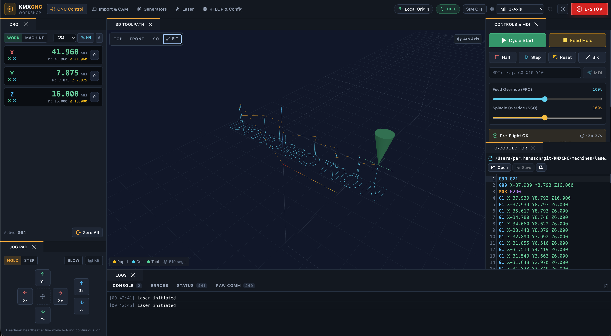

# KMotionXCNC

Web CNC interface for [KMotionX](https://github.com/parhansson/KMotionX).



## Run the frontend locally

Prerequisites: Node.js 22 and npm (Angular 18 also supports Node.js 18.19.1+
and 20.11.1+). The repository contains two packages: `camx` (the local CAM
library) and `ng2` (the Angular/webpack app).
Run these commands from the repository root:

```sh
cd camx
npm ci
npm run build
cd ../ng2
npm ci
npm run dev
```

Open **http://localhost:8081/** (the app redirects to `/gcode`). The dev server
serves the frontend on port 8081. You can load the interface without a CNC
controller, but live status, files, and machine controls require the backend.

For a production frontend bundle, run `npm run build` in `ng2`. The output is
written to the repository's `kmx/` directory.

## Backend connection

The frontend currently connects directly to `http://localhost:8080` for the
HTTP API and `ws://localhost:8080/ws` for status updates. To use those features,
install and run a compatible `kmxWeb` backend on the same machine, listening on
port 8080. The backend is **not built from this repository**: there is no
`configure` or `make` step here. The backend also requires a KMotionX
installation for machine control. Running the frontend alone will show a
disconnected state.
